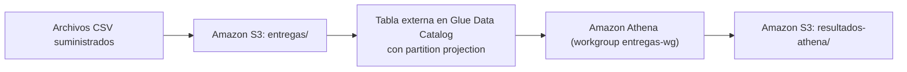

# Final Ingeniería de Datos 2026-2: Entregas con S3, Glue (partition projection) y Athena

Solución del punto 1 del final ([enunciado](ENUNCIADO.md)). Los CSV diarios de intentos de entrega se guardan en S3. La tabla externa de Glue Data Catalog describe su esquema con **partition projection** por `fecha`, y Athena los consulta y escribe los resultados en otro prefijo del mismo bucket. No se usan crawlers, `MSCK REPAIR TABLE`, `ALTER TABLE ADD PARTITION` ni particiones creadas con Terraform.



## Estructura

```text
├── README.md                 instrucciones reproducibles (este archivo)
├── ENUNCIADO.md              enunciado original del docente
├── .gitignore                excluye credenciales, *.tfstate y .terraform/
├── infraestructura/          Terraform: principal.tf, variables.tf, salidas.tf
├── consultas/                SQL de Athena
├── scripts/                  athena.py (ejecuta, descarga y registra) y consultas.sh (etapas)
├── data/entregas/            CSV suministrados (sin modificar)
├── resultados_esperados/     referencias suministradas (no se suben a S3)
├── resultados/inicial|final/ resultados obtenidos en Athena por etapa
├── evidencias/               apply, outputs, ejecuciones, comparaciones, destroy
└── respuestas.md             preguntas conceptuales
```

## Prerrequisitos

- Ubuntu en WSL2 (o Linux/macOS) con `bash`, `python3` (solo biblioteca estándar) y `git`.
- [Terraform](https://developer.hashicorp.com/terraform/install) >= 1.5 (proveedor `hashicorp/aws ~> 5.0`).
- AWS CLI v2 configurada con un usuario IAM con permisos sobre S3, Glue y Athena (`aws configure` o `export AWS_PROFILE=<perfil>`).
- Comprobación:

```bash
terraform -version
aws --version
aws sts get-caller-identity
```

## Configuración

| Variable (`infraestructura/variables.tf`) | Valor por defecto |
|---|---|
| `region` | `us-east-1` |
| `prefijo_bucket` | `de-final-entregas` (el bucket queda como `de-final-entregas-<id_cuenta>`) |
| `nombre_base_datos` | `entregas_db` |
| `nombre_tabla` | `entregas` |
| `nombre_workgroup` | `entregas-wg` |
| `fecha_inicio`, `fecha_fin` | `2026-10-01`, `2026-10-03` (rango proyectado, ambos incluidos) |

Las consultas SQL usan el nombre calificado `entregas_db.entregas`. Si se cambia `nombre_base_datos` o `nombre_tabla`, también hay que actualizar los `.sql`.

### Recursos definidos en Terraform

1. Bucket S3 privado (`aws_s3_bucket`) con bloqueo total de acceso público, propiedad `BucketOwnerEnforced` y cifrado SSE-S3.
2. Prefijos `entregas/` (datos) y `resultados-athena/` (resultados de Athena), creados como marcadores vacíos.
3. Base de datos de Glue `entregas_db`.
4. Tabla externa `entregas`:
   - Columnas `id_envio string, ciudad string, transportadora string, estado string, duracion_minutos int`, en ese orden.
   - `LazySimpleSerDe` con `field.delim = ","` y `skip.header.line.count = 1`.
   - Clave de partición `fecha string`.
   - `projection.enabled = true`, `projection.fecha.type = date`, `projection.fecha.format = yyyy-MM-dd`, `projection.fecha.range = 2026-10-01,2026-10-03`, `projection.fecha.interval = 1`, `projection.fecha.interval.unit = DAYS`.
   - `storage.location.template = s3://<bucket>/entregas/fecha=${fecha}/`. La plantilla termina en `/` porque describe el prefijo de la partición; el objeto es `.../fecha=<fecha>/entregas.csv`.
5. Workgroup de Athena `entregas-wg`, con resultados en `s3://<bucket>/resultados-athena/` y `enforce_workgroup_configuration = true`.
6. Outputs: `bucket`, `base_datos`, `tabla`, `workgroup`, región, ubicaciones, plantilla y rango de proyección.

## 1. Despliegue

```bash
cd infraestructura
terraform init
terraform fmt
terraform validate
terraform apply -auto-approve -no-color 2>&1 | tee ../evidencias/aplicacion_terraform.txt
terraform output -json > ../evidencias/outputs.json
cd ..
```

Evidencias: `evidencias/aplicacion_terraform.txt` y `evidencias/outputs.json`.

## 2. Demostración inicial: días 1 y 2

Se cargan **solo** los dos primeros archivos, uno por uno (sin carga recursiva):

```bash
BUCKET=$(python3 -c 'import json;print(json.load(open("evidencias/outputs.json"))["bucket"]["value"])')
aws s3 cp "data/entregas/fecha=2026-10-01/entregas.csv" "s3://$BUCKET/entregas/fecha=2026-10-01/entregas.csv"
aws s3 cp "data/entregas/fecha=2026-10-02/entregas.csv" "s3://$BUCKET/entregas/fecha=2026-10-02/entregas.csv"
aws s3 ls "s3://$BUCKET/entregas/" --recursive | tee evidencias/s3_objetos_inicial.txt
```

Consultas de la etapa inicial:

```bash
bash scripts/consultas.sh inicial
```

`scripts/athena.py` ejecuta cada `.sql` en el workgroup `entregas-wg`, espera a que termine y descarga el CSV que Athena escribió en `resultados-athena/`. Luego lo guarda sin comillas, con separador coma y finales LF, en `resultados/inicial/`, y agrega la fila `etapa,archivo_sql,id_ejecucion,archivo_resultado` a `evidencias/ejecuciones_athena.csv`. Al final compara con `resultados_esperados/*_inicial.csv` usando `diff` y deja el reporte en `evidencias/comparacion_inicial.txt`.

| Consulta | Resultado | Referencia |
|---|---|---|
| `consultas/conteo_registros.sql` (verificación extra: 12 registros) | `resultados/inicial/conteo_registros.csv` | — |
| `consultas/intentos_por_fecha_estado.sql` | `resultados/inicial/intentos_por_fecha_estado.csv` | `intentos_por_fecha_estado_inicial.csv` |
| `consultas/porcentaje_exito_por_fecha_ciudad.sql` | `resultados/inicial/porcentaje_exito_por_fecha_ciudad.csv` | `porcentaje_exito_por_fecha_ciudad_inicial.csv` |
| `consultas/duracion_promedio_2026-10-02.sql` | `resultados/inicial/duracion_promedio_2026-10-02.csv` | `duracion_promedio_2026-10-02.csv` |

Criterios de las consultas:
- **Intentos:** `COUNT(*)` por `fecha, estado`, ordenado de forma ascendente por ambos.
- **Porcentaje:** `100 * CAST(exitosas AS DOUBLE) / COUNT(*)`, con un denominador que incluye todos los estados. Se redondea con `ROUND(...,2)` y se convierte a `DECIMAL(5,2)` para conservar siempre dos decimales.
- **Duración:** `AVG` solo sobre `estado = 'entregado'` y `fecha = '2026-10-02'`, sin incluir los ceros de los intentos fallidos. Se redondea a dos decimales.

## 3. Nueva fecha: día 3 (solo subir y consultar)

Sin tocar Terraform ni las propiedades de la tabla:

```bash
aws s3 cp "data/entregas/fecha=2026-10-03/entregas.csv" "s3://$BUCKET/entregas/fecha=2026-10-03/entregas.csv"
aws s3 ls "s3://$BUCKET/entregas/" --recursive | tee evidencias/s3_objetos_final.txt
bash scripts/consultas.sh final
```

- `consultas/verificacion_tercer_dia.sql` tiene tres sentencias, que se ejecutan por separado:
  - Los 6 registros de `2026-10-03` → `resultados/final/verificacion_tercer_dia.csv`.
  - Los conteos por estado de ese día → `resultados/final/verificacion_tercer_dia_conteo_estado.csv`.
  - Los registros del tercer día (6) y el total de la tabla (18) → `resultados/final/verificacion_total_registros.csv`.
- Se vuelven a ejecutar `intentos_por_fecha_estado.sql` y `porcentaje_exito_por_fecha_ciudad.sql`, que no tienen filtro de fecha y por eso cubren todo el rango. Se comparan con las referencias `*_final.csv`.
- La duración del día 2 se vuelve a ejecutar como control (`resultados/final/duracion_promedio_2026-10-02.csv`) y debe dar el mismo valor.
- Las ejecuciones quedan con etapa `final` en `evidencias/ejecuciones_athena.csv`, y la comparación en `evidencias/comparacion_final.txt`.

## 4. Limpieza

Después de guardar (y confirmar en git) las evidencias anteriores:

```bash
BUCKET=$(python3 -c 'import json;print(json.load(open("evidencias/outputs.json"))["bucket"]["value"])')
aws s3 rm "s3://$BUCKET" --recursive | tee evidencias/vaciado_bucket.txt
cd infraestructura
terraform destroy -auto-approve -no-color 2>&1 | tee ../evidencias/eliminacion_terraform.txt
cd ..
# Verificación de que ya no existen (los errores NoSuchBucket / EntityNotFound son lo esperado)
{ aws s3api head-bucket --bucket "$BUCKET" 2>&1; aws glue get-database --name entregas_db 2>&1; aws athena get-work-group --work-group entregas-wg 2>&1; } | tee -a evidencias/eliminacion_terraform.txt
```

El bucket tiene `force_destroy = true` y el workgroup también, así que `terraform destroy` elimina todo aunque queden objetos o historial de consultas. El vaciado previo deja evidencia explícita de que se borraron los datos y los resultados de Athena.

## Evidencias

| Archivo | Contenido |
|---|---|
| `evidencias/aplicacion_terraform.txt` | Salida de `terraform apply` |
| `evidencias/outputs.json` | `terraform output -json` (bucket, base de datos, tabla, workgroup) |
| `evidencias/s3_objetos_inicial.txt`, `s3_objetos_final.txt` | Objetos en `entregas/` en cada etapa |
| `evidencias/ejecuciones_athena.csv` | Etapa, SQL, `QueryExecutionId` y resultado de cada ejecución |
| `evidencias/comparacion_inicial.txt`, `comparacion_final.txt` | `diff` contra `resultados_esperados/` |
| `evidencias/vaciado_bucket.txt` | Objetos eliminados antes del destroy |
| `evidencias/eliminacion_terraform.txt` | Salida de `terraform destroy` y verificación |

El estado de Terraform (`*.tfstate`), la carpeta `.terraform/` y las credenciales no se publican (ver `.gitignore`).
